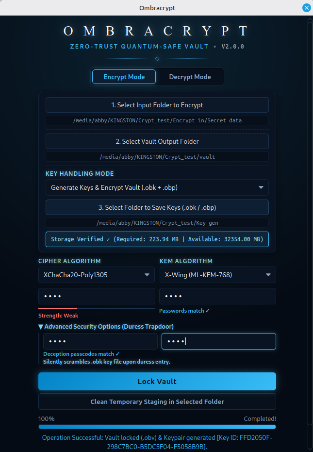

<p align="center">
  
</p>

<h1 align="center">Ombracrypt</h1>

<p align="center">
  <strong>Offline Post-Quantum Hybrid Cryptographic Vault for Cross-Platform Data Sovereignty</strong>
</p>

<p align="center">
  
  
  <a href="LICENSE"></a>
</p>

---

## Executive Summary

Ombracrypt is an offline-capable, network-independent desktop cryptographic vault designed to secure high-value files and directories against contemporary interception and future quantum cryptanalysis. Built on a memory-safe Rust core and the lightweight Tauri desktop framework, Ombracrypt safeguards data at rest against "Store Now, Decrypt Later" (SNDL) attacks by combining lattice-based post-quantum cryptography with classical elliptic-curve key exchange.

Ombracrypt performs cryptographic derivation, encryption, decryption, and extraction locally without requiring internet connectivity, remote cryptographic services, or telemetry infrastructure. During encryption, directory trees stream through bounded in-process buffers and an authenticated cipher pipeline without creating an intermediate unencrypted TAR file on disk. Designated plaintext buffers are explicitly zeroized in memory after processing. Encrypted payloads (`.obv`) and cryptographic keys (`.obk` / `.obp`) are separated by design, enabling users to store encrypted archives on untrusted public clouds or external media while retaining private decapsulation keys on offline hardware.

<p align="center">
  
</p>

---

## Release and Migration Status

| Track | Version | Status & Deployment Guidance |
| :--- | :--- | :--- |
| **Legacy** | `v1.0.0` | **Deprecated architecture.** Existing binary installers remain accessible on GitHub Releases for historical access and data recovery. Not recommended for new deployments. |
| **Development** | `v2.0.0` | **Current architecture under active development on `main`.** The v2.0.0 development source is available on `main` for local compilation and testing. It remains pre-release software; official binary packages will follow release-candidate validation. |

---

## Architectural Principles

### Local, Zero-Escrow Cryptographic Architecture
Ombracrypt does not operate a centralized key-management service, remote recovery infrastructure, or third-party escrow mechanism. Cryptographic operations are performed locally, and users retain sole responsibility for managing, protecting, and backing up their private key material and recovery artifacts.

### No Centralized Recovery
Ombracrypt maintains no administrative backdoor, recovery phrase, or password reset mechanism. Loss or corruption of the required `.obk` private key file or Master Password results in permanent, irreversible loss of access to the encrypted vault. Users are responsible for maintaining secure, independent backups of their cryptographic artifacts on isolated physical media.

---

## Key Capabilities

* **Dual-Profile Hybrid KEM:** Combines post-quantum lattice primitives with classical Diffie-Hellman (RFC 7748 X25519) to resist quantum cryptanalysis while retaining classical computational hardness.
* **In-Memory Encryption Streaming:** Streams directory trees directly through bounded in-process buffers into an authenticated encryption pipeline in chunks of up to 1&nbsp;MiB, eliminating unencrypted intermediate TAR archives on disk during encryption.
* **Designated Buffer Zeroization:** Designated plaintext buffers are wrapped in zeroizing containers and cleared from memory immediately following cipher operations.
* **Cryptographic Artifact Separation (`.obv` / `.obk` / `.obp`):** Encrypted vaults (`.obv`) are mathematically decoupled from private keys (`.obk`). Reusable public sealing keys (`.obp`) enable one-way vault encryption without exposing private decapsulation keys.
* **Interactive Duress Response:** An optional deception passcode triggers an in-place CSPRNG overwrite attempt against the target `.obk` private key file on disk, enforcing `st_nlink > 1` rejection and returning a generic authentication failure message.
* **Defensive Filesystem Architecture:** Enforces pre-flight storage allocation checks, canonical path collision guards, advisory sentinel file locks, best-effort transactional rollback, and defensive TAR parsing limits.
* **Offline & Network-Independent:** Operates without network dependencies, external APIs, cloud accounts, or diagnostic telemetry beacons.

---

## Downloads & Artifact Overview

Pre-compiled binary packages for desktop platforms are published on [GitHub Releases](https://github.com/ABiswasDev/Ombracrypt/releases):

| Operating System | Package Formats | Architecture & Distribution |
| :--- | :--- | :--- |
| **Linux** | `.deb`, `.AppImage`, `.rpm` | x86_64 (Debian, Ubuntu, Linux Mint, Fedora, RHEL, Arch) |
| **Windows** | `.msi`, `.exe` | x86_64 (Windows 10, Windows 11) |
| **macOS** | `.dmg` | Apple Silicon (ARM64, macOS 12+) |

For setup instructions and usage workflows, refer to the [Quickstart Guide](docs/QUICKSTART.md).

### The Three Vault Artifacts

```text
[ Input Folder ]  ───(Encrypt)───>  [ Vault Payload: .obv ]
                                    [ Private Key:   .obk ]  <── Keep Offline & Protected
                                    [ Public Key:    .obp ]  <── Shareable for Sealing
```

1. **`.obv` (Encrypted Vault):** The authenticated, encrypted payload containing the streaming archive, chunk-level authentication tags, metadata preamble, and KEM ciphertext. Suitable for transit or storage on untrusted media.
2. **`.obk` (Private Key File):** The private decapsulation key file required to unlock the vault. Must be stored securely on isolated offline media. Possession of the `.obk` file alone is insufficient to decrypt a vault without the Master Password, but the file must still be protected against unauthorized physical and digital access.
3. **`.obp` (Public Sealing Key):** The public encapsulation key file. Can be shared with automated backup agents or collaborators to encrypt vaults without granting them the ability to decrypt existing archives.

### Metadata Transparency Notice

The `.obv` header is not encrypted. It exposes the following operational parameters in cleartext:

| Header Field | Size | Description |
| :--- | :--- | :--- |
| **Format Magic & Version** | 5 bytes | File format identifier (`OBV02`) |
| **Cipher Identifier** | 1 byte | Symmetric algorithm (`1` = XChaCha20-Poly1305, `2` = AES-256-GCM) |
| **KEM Profile Identifier** | 1 byte | Key encapsulation profile (`1` = X-Wing, `2` = Cypherpunk) |
| **Argon2id Parameters** | 12 bytes | Little-endian `u32` triple: memory cost, pass count, parallelism lanes |
| **Source Content Size** | 8 bytes | Little-endian `u64`: exact aggregate uncompressed content bytes across all source files (excluding TAR headers, directory records, and padding) |
| **Salt** | 16 bytes | Cryptographically secure random salt used for Argon2id and HKDF-Extract |
| **Nonce Length** | 1 byte | Byte length of the base initialization vector (`24` for XChaCha20, `12` for AES-GCM) |
| **Base Nonce** | 12 or 24 bytes | Cryptographically secure random base initialization vector |
| **KEM Ciphertext Length** | 2 bytes | Little-endian `u16`: size of the encapsulated KEM payload |
| **KEM Ciphertext** | 1,120 or 1,600 bytes | Raw encapsulated post-quantum hybrid ciphertext |

Although these fields are not confidential, their integrity is cryptographically protected: the entire serialized header is hashed using SHA-256, and its 32-byte digest is bound into the authenticated associated data (AAD) of every encrypted payload chunk. Any modification to the cleartext header causes authentication failure when the affected chunk is validated during extraction.

The vault's overall file size and chunk framing reveal the approximate total size of the protected payload including archive overhead. Vault filenames may also disclose contextual information if source folder names are not sanitized prior to storage.

---

## Cryptographic Specification & Architecture

Ombracrypt uses a layered cryptographic construction combining memory-hard password derivation, post-quantum hybrid key encapsulation, and chunked authenticated symmetric streaming.

```text
Master Password + 16-byte Salt              Recipient Public Key (.obp)
                 │                                         │
                 ▼                                         ▼
   Argon2id (64 MiB, 3 T, 4 p)                  Hybrid KEM Encapsulation
                 │                                  (ML-KEM + X25519)
                 ▼                                         │
      Derived Key (32 bytes)                               ▼
                 │                            KEM Shared Secret (32 bytes)
                 │                                         │
                 └───────────────────┬─────────────────────┘
                                     │
                                     ▼
                   IKM = Derived Key ∥ KEM Shared Secret (64 bytes)
                                     │
                                     ▼
                   HKDF-Extract(Salt, IKM) using SHA-256
                                     │
                                     ▼
                   HKDF-Expand (Info: "OMBRACRYPT-V2-MASTER-KEY")
                                     │
                                     ▼
                   Master Symmetric Key (32 bytes)
```

### 1. Hybrid Key Encapsulation Mechanisms (KEM)

Ombracrypt implements two hybrid key encapsulation profiles:

| Profile Name | Specification Reference | Cryptographic Primitives | Ciphertext Wire Size | Private Key Structure (`.obk`) |
| :--- | :--- | :--- | :--- | :--- |
| **Profile 1: X-Wing** | [IETF draft-connolly-cfrg-xwing-kem-11](https://datatracker.ietf.org/doc/draft-connolly-cfrg-xwing-kem/) | NIST FIPS 203 ML-KEM-768 + RFC 7748 X25519 | 1,120 bytes | 86 bytes (32-byte canonical seed + duress block) |
| **Profile 2: Cypherpunk** | Ombracrypt Custom Non-Standard Profile | NIST FIPS 203 ML-KEM-1024 + RFC 7748 X25519 | 1,600 bytes | 3,254 bytes (Expanded key material + duress block) |

#### Profile 1: X-Wing (ML-KEM-768 + X25519)
Profile 1 implements the X-Wing construction defined in IETF Internet-Draft `draft-connolly-cfrg-xwing-kem-11` (work in progress):
* **Key Derivation:** A 32-byte seed expands via SHAKE256 into 96 bytes. The first 64 bytes seed deterministic key generation for ML-KEM-768 ($d \parallel z$), while the final 32 bytes form the scalar for X25519.
* **On-the-Fly Expansion:** Private keys (`.obk`) store the 32-byte seed directly. Key expansion occurs in volatile memory upon unlock; expanded key material is zeroized immediately after decapsulation.
* **Combiner:** Shared secret synthesis strictly follows the draft concatenation formula using the canonical 6-byte domain separator `5c 2e 2f 2f 5e 5c` (ASCII `\.//^\`):
  $$\text{ss} = \text{SHA3-256}\left(\text{ss}_{\text{ML-KEM}} \parallel \text{ss}_{\text{X25519}} \parallel \text{ct}_{\text{X25519}} \parallel \text{pk}_{\text{X25519}} \parallel \texttt{5c2e2f2f5e5c}_{16}\right)$$

#### Profile 2: Cypherpunk (ML-KEM-1024 + X25519)
A custom hybrid profile engineered for environments seeking Category 5 post-quantum security parameters:
* **Primitives:** Combines NIST FIPS 203 ML-KEM-1024 with classical RFC 7748 X25519 using the isolated 6-byte domain separator `OMBMX2`.
* **Standardization Notice:** Profile 2 is a custom Ombracrypt design. While ML-KEM-1024 uses the NIST Category 5 parameter set and X25519 follows RFC 7748, the hybrid composition itself is not an independently standardized NIST or IETF profile.

#### Post-Quantum Primitives Implementation
ML-KEM encapsulation and decapsulation operations are executed by the `fips203` crate, a pure-Rust, `#![no_std]` implementation of the finalized NIST FIPS 203 standard. The crate documents source-level constant-time behavior with the documented exception of the public parameter $\rho$. These properties describe the underlying library primitive and should not be interpreted as an independent whole-application security audit.

---

### 2. Password Key Derivation & Master Key Synthesis

* **Argon2id Memory-Hard KDF:** User passphrases pass through Argon2id configured with explicit parameters:
  * Memory Cost ($m$): $65{,}536\text{ KiB}$ ($64\text{ MiB}$)
  * Time Cost ($t$): $3\text{ passes}$
  * Parallelism ($p$): $4\text{ lanes}$
  * Salt: 16 cryptographically secure random bytes generated per vault operation.
* **RFC 5869 HKDF-SHA256 Master Key Expansion:** The 32-byte Argon2id output and the 32-byte KEM hybrid shared secret concatenate into a 64-byte input keying material ($\text{IKM}$). HKDF-SHA256 expands this input using the vault header's 16-byte salt and domain context `OMBRACRYPT-V2-MASTER-KEY` into a uniform 256-bit symmetric Master Key:
  $$\text{PRK} = \text{HKDF-Extract}(\text{Salt}, \text{ArgonKey} \parallel \text{HybridSS})$$
  $$\text{MasterKey} = \text{HKDF-Expand}(\text{PRK}, \texttt{"OMBRACRYPT-V2-MASTER-KEY"}, 32)$$

---

### 3. Streaming AEAD Engine

* **In-Memory Streaming:** Archive streams pass through bounded in-process buffers into an authenticated cipher pipeline. Plaintext buffers are wrapped in zeroizing containers and cleared immediately following cipher operations. This zeroization applies to designated internal buffers and does not guarantee protection against operating-system memory paging, crash dumps, or physical RAM imaging.
* **Symmetric Ciphers:**
  * **XChaCha20-Poly1305:** 256-bit key with an extended 192-bit (24-byte) random base nonce.
  * **AES-256-GCM:** 256-bit key with a 96-bit (12-byte) random base nonce.
* **Chunk Framing:** Data is encrypted in discrete chunks of up to 1&nbsp;MiB. The final chunk in a stream may be smaller.
* **Per-Chunk Nonce Derivation:** To prevent nonce reuse across multi-gigabyte streams, each chunk uses a unique nonce derived by XORing a 64-bit little-endian chunk counter ($i$) into the final 8 bytes of the base nonce:
  $$\text{Nonce}_i = \text{BaseNonce}[..L-8] \parallel \left(\text{BaseNonce}[L-8..L] \oplus \text{to\_le\_bytes}(i)\right)$$
* **Header-Bound Associated Data (AAD):** The serialized cleartext header is hashed using SHA-256 to produce a 32-byte digest. For each chunk ($i$), this digest is combined with an 8-byte chunk index and a 1-byte finalization flag to construct a 41-byte AAD payload:
  $$\text{AAD}_i = \text{SHA-256}(\text{VaultHeader})_{32} \parallel \text{to\_le\_bytes}(i)_{8} \parallel \text{IsFinal}_{1}$$
  This cryptographically binds the cleartext header and chunk sequence to every ciphertext block. Any modification to the cleartext header causes authentication failure when the affected chunk is validated during extraction.

---

### 4. Interactive Duress Key Overwrite

Ombracrypt includes an optional defensive countermeasure for physical coercion scenarios:

* **The Phantom Block:** When generating a keypair, an optional Deception Passcode derives a 32-byte block via Argon2id using an independent salt, which is stored in the `.obk` file. If no passcode is configured, 32 bytes of CSPRNG noise are written.
* **Duress Verification:** During decryption, the entered passphrase is verified in constant time against the Phantom Block.
* **In-Place Overwrite Attempt:** If the Deception Passcode matches:
  * The target `.obk` file is checked to ensure it is a regular file within valid bounds ($64\text{ B} \le \text{size} \le 8{,}192\text{ B}$) and not a symlink.
  * On Unix, the operation rejects targets with multiple hard links (`st_nlink > 1`) and verifies matching device (`st_dev`) and inode (`st_ino`) identity between the inspected path and opened file descriptor.
  * The file is overwritten in place with CSPRNG noise and flushed via `sync_all()`.
  * The application halts and returns a standard decryption failure message:
    ```
    Decryption Failed! Data corruption or mismatched cryptographic key.
    ```
* **Operational Boundaries & Limitations:** Entering the duress passcode attempts to overwrite the selected local `.obk` file. Data recovery may still be possible from separate offline backups, but the targeted file should be treated as destroyed. In-place overwriting does not guarantee physical erasure on NAND flash storage subject to controller wear-leveling, filesystem snapshots, or copy-on-write filesystems (Btrfs, ZFS, APFS).

---

## Filesystem Safety & Defensive Architecture

Writing and extracting archives on shared or untrusted storage introduces race conditions and namespace collisions. Ombracrypt addresses these through defensive filesystem guards implemented in `src-tauri/src/fs_guard.rs`.

### Staging Lifecycle & Permissions
* **Restricted Staging Artifacts:** Staged files use a strict 54-byte namespace (`.ombracrypt_part_<32hex>.part`). Private key staging files enforce strict `0600` (owner read/write) permissions on Unix. Extraction directories use a strict 50-byte namespace (`.ombracrypt_stage_<32hex>`) with `0700` (owner read/write/traverse) permissions on Unix. Public keys (`.obp`) and vault archives (`.obv`) inherit standard system umask permissions.
* **Sentinel Locking:** Active extraction staging directories contain an exclusively locked `.active.lock` file descriptor.
* **Post-Lock File-Identity Validation:** Background cleaners attempting to sweep abandoned directories verify the locked file handle against the filesystem before unlinking. On Unix, the cleaner verifies `st_nlink > 0` and checks matching `st_dev` and `st_ino`. On Windows, the cleaner inspects `BY_HANDLE_FILE_INFORMATION` via `GetFileInformationByHandle` to confirm volume serial number and file index matching, preventing stale-handle deletion races.
* **Process-Local Registry:** A thread-safe global registry tracks active staging paths within the running process, preventing internal worker threads from cleaning files currently being written.

### Atomic No-Clobber Publication
Ombracrypt implements two distinct publication pathways depending on whether the artifact is a file or a directory:

1. **File Publication (`CommitRollbackGuard::commit_file`):** Staged files (`.obv`, `.obk`, `.obp`) promote to final destinations via atomic hard links on supported filesystems (ext4, NTFS, APFS, XFS, Btrfs, ZFS), followed by unlinking the staged `.part` entry. If hard-linking fails for reasons other than an existing target (such as across filesystem boundaries or on filesystems like FAT32 and exFAT), it falls back to native atomic no-replace operations.
2. **Directory Publication (`atomic_publish_dir_noreplace`):** Successfully decrypted directories promote from staging to destination directly via platform-native atomic no-replace syscalls:
   * **Linux:** `libc::renameat2` with `RENAME_NOREPLACE`
   * **macOS:** `libc::renamex_np` with `RENAME_EXCL`
   * **Windows:** `MoveFileExW` without `MOVEFILE_REPLACE_EXISTING`
   Directories are never published through hard links.
3. **Fail-Closed Guarantees:** If the target directory or file already exists—or is a dangling symlink—publication fails closed with an explicit error, leaving existing user files untouched. If the underlying filesystem lacks support for atomic no-replace operations, the operation aborts to prevent silent data clobbering.

### Best-Effort Transactional Rollback
Staging operations for multi-file commits (such as `.obv`, `.obk`, and `.obp` creation) are tracked by `CommitRollbackGuard`. If publication of a subsequent artifact fails, the transaction guard attempts to remove artifacts already committed during the operation. This rollback is not crash-atomic across multiple filesystem entries. Unexpected process termination, power loss, kernel failure, or filesystem errors may leave partially published artifacts behind.

### Archive Bomb & Path Traversal Mitigations
Untrusted TAR archives inside `.obv` containers pass through defensive boundary checks during extraction:
* **Path Traversal Prevention:** Rejects paths containing parent directories (`..`), absolute prefixes (`/`), or Windows drive letters.
* **Disallowed Entry Types:** Rejects non-regular filesystem objects (symlinks, hard links, FIFOs, sockets, character/block devices). Only regular files and directories are unpacked.
* **Anti-Bomb Limits:** Enforces a maximum recursion depth of $\le 64$ levels, relative path length of $\le 512$ bytes, component length of $\le 255$ bytes, and a total entry cap of $50{,}000$ items. Conflicting duplicate entry paths trigger immediate extraction termination.
* **Permission Sanitization:** Disables archive permission preservation and extended attributes. On Unix, special permission bits (setuid, setgid, sticky / `07000`) are stripped.

---

## Threat Model & Boundaries

### In Scope
* **Post-Quantum Data Confidentiality:** Protecting static archives on cloud storage or untrusted media against future cryptanalysis by quantum computers.
* **Cryptographic Agility:** Supporting both XChaCha20-Poly1305 and AES-256-GCM symmetric streaming alongside standard (X-Wing) and high-security (Cypherpunk) KEM profiles.
* **Artifact Decoupling:** Enabling workflows where vault data (`.obv`) and private keys (`.obk`) reside on isolated media.
* **Archive Safety:** Defending host filesystems against Zip-Slip traversal, symlink hijacking, and archive bomb denial-of-service during extraction.
* **Interactive Coercion Response:** Providing a mechanism to destroy private key material in place when forced to enter credentials.

### Out of Scope & Operational Realities
* **Compromised Host Operating Systems:** Cannot protect against active kernel rootkits, memory scrapers, keyloggers, or compromised display servers on the host machine.
* **Zero-Escrow Recovery:** There are no backdoors, recovery keys, or escrow bypasses. A lost Master Password or lost `.obk` file renders data permanently unrecoverable.
* **Offline Phantom Block Analysis:** The Duress Trapdoor is an interactive countermeasure. An adversary who clones the `.obk` file prior to the interaction can bypass the in-place overwrite.
* **Flash Storage Wear-Leveling Residue:** Overwriting an `.obk` file flushes CSPRNG noise to the filesystem, but SSD controllers using dynamic wear-leveling may retain latent physical flash blocks until trimmed or garbage-collected.
* **Decryption Staging Residue:** Encryption streams directly from memory without writing temporary TAR archives to disk. Decryption extracts validated plaintext files into a restricted local staging folder before atomic publication. A crash or power loss during extraction can leave partial plaintext files in that staging folder until cleared by the user.

---

## Verification & Conformance Test Suite

The cryptographic implementation and filesystem safety invariants of the Rust backend engine are validated through automated regression test suites executed across Ubuntu 22.04, macOS, and Windows runners via GitHub Actions:

```bash
cd src-tauri
cargo test --release
```

At the latest audited commit, the test suite reported 53 passing tests on Ubuntu, 53 on macOS, and 49 on Windows (platform-gated tests account for the variance).

### Coverage Breakdown

* **X-Wing Independent Reference KAT (`test_sprint10_xwing_independent_reference_kat`):** Byte-exact verification against independent Known-Answer Test fixtures generated with Cloudflare CIRCL v1.6.5, validating public key encoding (1,216 bytes), ciphertext layout (1,120 bytes), ephemeral X25519 scalar multiplication, and decapsulated shared secret matching.
* **IETF Combiner KAT (`test_sprint9_xwing_combiner_specification_kat`):** Validates the SHA3-256 combiner against the static literal test vector using the `5c 2e 2f 2f 5e 5c` domain separator.
* **NIST FIPS 202 & RFC 7748 KATs (`test_sprint6_nist_fips202_and_rfc7748_official_kat_vectors`):** Asserts SHA3-256, SHAKE256, and X25519 Diffie-Hellman operations against official standards vectors.
* **Implicit Rejection Verification:** Asserts that decapsulating corrupted ML-KEM ciphertexts triggers implicit rejection, returning an alternate pseudorandom key rather than failing noisily.
* **Filesystem Race & Concurrency Tests:** Validates multi-threaded contention using `Arc<Barrier>` across simultaneous file and directory publishers (`atomic_publish_noreplace` and `atomic_publish_dir_noreplace`), asserting that winning publishers commit atomically while losers fail closed without clobbering data.
* **Sentinel & Stale FD Validation:** Tests active locked directory protection, stale sentinel reclamation, and post-lock file-identity verification (`st_nlink == 0` on Unix and `BY_HANDLE_FILE_INFORMATION` index validation on Windows).

> **Audit Notice:** Automated regression tests and Known-Answer Tests confirm specification conformance and internal implementation consistency, but do not substitute for an independent third-party security audit. CI runs validate the native Rust backend engine; they do not perform complete frontend packaging or installer compilation.

---

## Building from Source

### Prerequisites

* [Git](https://git-scm.com/)
* [Node.js](https://nodejs.org/) (v18 or higher)
* [Rust & Cargo](https://rustup.rs/) (latest stable toolchain)

#### System Dependencies

* **Linux (Debian / Ubuntu / Linux Mint):**
  ```bash
  sudo apt-get update
  sudo apt-get install -y libwebkit2gtk-4.1-dev build-essential curl wget file \
                          libssl-dev libgtk-3-dev libayatana-appindicator3-dev \
                          librsvg2-dev libxdo-dev
  ```
* **macOS:** Xcode Command Line Tools:
  ```bash
  xcode-select --install
  ```
* **Windows:** Visual Studio C++ Build Tools with the **Desktop development with C++** workload.

### Compilation Steps

```bash
# 1. Clone the repository
git clone [https://github.com/ABiswasDev/Ombracrypt.git](https://github.com/ABiswasDev/Ombracrypt.git)
cd Ombracrypt

# 2. Install reproducible frontend dependencies
npm ci

# 3. Launch application in desktop development mode
npm run tauri dev

# 4. Compile optimized standalone installer bundles
npm run tauri build
```

Compiled desktop bundles (`.deb`, `.AppImage`, `.rpm`, `.msi`, `.exe`, `.dmg`) are output to `src-tauri/target/release/bundle/`.

---

## Project Structure

```text
ombracrypt/
├── .github/
│   └── workflows/
│       ├── ci.yml                     # Multi-platform CI backend regression suite
│       └── release.yml                # Multi-platform release bundle packaging
├── docs/
│   └── QUICKSTART.md                  # User onboarding & key generation guide
├── images/                            # Application captures and schematics
├── src/                               # Frontend Presentation Layer (Tauri WebView)
│   ├── assets/                        # Static UI assets and icons
│   ├── index.html                     # Fixed-geometry workspace layout & controls
│   ├── main.js                        # IPC event dispatchers, progress telemetry
│   └── styles.css                     # Ombraveil dark UI styling & typography
├── src-tauri/                         # Native Rust Core Engine
│   ├── build.rs                       # Tauri native build script
│   ├── Cargo.lock                     # Locked Rust dependency tree
│   ├── Cargo.toml                     # Manifest (fips203, x25519-dalek, sha3, argon2)
│   ├── tauri.conf.json                # Fixed 650x900 window geometry & app metadata
│   ├── capabilities/
│   │   └── default.json               # Desktop security policy & IPC permissions
│   ├── icons/                         # Desktop application icon set
│   ├── tests/
│   │   └── fixtures/
│   │       └── xwing_revision11/      # CIRCL v1.6.5 Known-Answer Test fixtures
│   └── src/
│       ├── main.rs                    # Desktop application entry point
│       ├── lib.rs                     # Tauri command handlers & application state
│       ├── crypto.rs                  # Hybrid KEM (X-Wing & Cypherpunk), Argon2id, HKDF
│       ├── fs_guard.rs                # Staging namespaces, sentinel locking, atomic commit
│       ├── pipeline.rs                # Streaming encryption & decryption controllers
│       ├── stream.rs                  # In-memory chunked AEAD readers/writers & TAR guards
│       ├── deception.rs               # Duress key scrambling & metadata validation
│       └── tests.rs                   # Multi-platform regression & KAT test suite
├── tools/
│   └── xwing-fixture-generator/       # Go / CIRCL reference KAT generator
├── package-lock.json                  # Locked npm dependency tree
├── package.json                       # Node workspace & build scripts
├── SECURITY.md                        # Vulnerability disclosure policy
└── LICENSE                            # Cryptographic Autonomy License 1.0
```

---

## Author & Maintainer

* **Abhishek Biswas** – *Lead Architect & Maintainer* – [@ABiswasDev](https://github.com/ABiswasDev)

---

## License & Legal Terms

* **Cryptographic Autonomy License 1.0 (CAL-1.0):** Ombracrypt is open-source software licensed under the Cryptographic Autonomy License (CAL-1.0). You are free to inspect, modify, and redistribute this software. Any deployment or derivative service offered over a network legally requires providing users access to the source code, their data, and their cryptographic keys/credentials, guaranteeing data sovereignty without vendor lock-in.
* **Cryptographic & Research Notice:** Ombracrypt is designed for defensive personal data sovereignty. The maintainers assume zero liability for data loss resulting from forgotten passwords, lost key files, or unauthorized use. Users are solely responsible for ensuring compliance with cryptographic import, export, and usage regulations in their respective jurisdictions.

---

> ### ⚠️ Critical Security Warning & Zero-Escrow Notice
>
> * **Zero Backdoors, Zero Escrow:** Ombracrypt enforces a local, zero-escrow security architecture. There are no backdoor master keys, recovery phrases, password reset mechanisms, or administrative bypasses. If you lose your Master Password or your `.obk` private key file, your data is **cryptographically unrecoverable**. Always maintain independent, verified backups of your private keys in offline, tamper-evident physical storage.
> * **Irreversible Duress Key Scrambling:** Entering your optional Deception Passcode initiates an in-place CSPRNG overwrite of the selected `.obk` private key file on disk. Once overwritten, that specific key file copy is permanently corrupted, and any vault relying exclusively upon it **can never be decrypted again**. Data recovery is only possible if an independent offline backup of the key exists. Configure and use this countermeasure only with full awareness of its operational consequences.