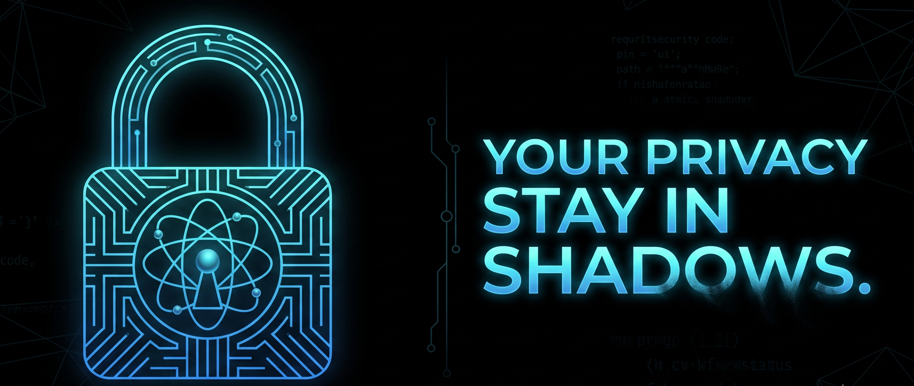

<p align="center">
  
</p>

<h1 align="center">Ombracrypt CLI</h1>

<p align="center">
  <strong>Offline Post-Quantum Hybrid Cryptographic Vault for the Terminal</strong>
</p>

<p align="center">
  
  
  <a href="https://github.com/ABiswasDev/Ombracrypt/blob/main/LICENSE"></a>
</p>

---

## Executive Summary

**Ombracrypt CLI** (`apps/cli` in the [Ombracrypt](https://github.com/ABiswasDev/Ombracrypt) workspace) is a local-first, zero-escrow post-quantum cryptographic vault engineered for terminal environments, automation scripts, and headless servers. It protects directory archives against contemporary interception and "Harvest Now, Decrypt Later" (HNDL) quantum attacks.

Operating offline with **zero telemetry, no cloud dependencies, and zero key custody**, Ombracrypt Desktop and Ombracrypt CLI share the canonical `ombracrypt-core` cryptographic and filesystem engine and `OMBV02` container format. Cross-application compatibility for vaults (`.obv`) and keys (`.obp`/`.obk`) is verified through shared-core interoperability tests (`apps/cli/tests/interop_tests.rs`) and frozen `v2.1.0` compatibility fixtures.

---

## Key Architectural Capabilities

* **Dual-Profile Post-Quantum Hybrid KEM:**
  * **Profile 1: X-Wing (Default):** Combines NIST FIPS 203 ML-KEM-768 with classical RFC 7748 X25519 using the IETF draft (`draft-connolly-cfrg-xwing-kem-11`) domain separator (`\.//^\`), SHAKE256 seed expansion, and SHA3-256 combiner.
  * **Profile 2: Cypherpunk:** Custom non-standard high-security profile combining NIST FIPS 203 ML-KEM-1024 with classical X25519.
* **Folder-Centric In-Memory Encryption Streaming:** Streams directory trees directly through bounded in-process buffers in chunks up to 1&nbsp;MiB, eliminating unencrypted intermediate TAR archives on disk during encryption.
* **Cryptographic Artifact Separation:**
  * `.obv` **(Encrypted Vault):** Authenticated ciphertext stream bound to serialized header metadata via SHA-256 Additional Authenticated Data (AAD).
  * `.obk` **(Private Decapsulation Key):** Offline decapsulation key created with `0600` owner-only permissions on POSIX filesystems (Linux/macOS) that honor Unix mode bits. On Windows, file creation currently inherits parent directory ACLs, and removable filesystems such as `FAT32`/`exFAT` do not support permission bits or ACLs; store `.obk` files only in private user-owned directories or physically controlled offline media.
    * **X-Wing profile:** Exactly **86 bytes** (5 B magic + 1 B `kem_id` + 16 B salt + 32 B seed + 32 B phantom block).
    * **Cypherpunk profile:** Exactly **3,254 bytes** (5 B magic + 1 B `kem_id` + 16 B salt + 3,168 B ML-KEM-1024 d<sub>k</sub> + 32 B X25519 s<sub>k</sub> + 32 B phantom block).
  * `.obp` **(Public Sealing Key):** Reusable public key allowing one-way vault encryption for individual or group recipients without granting decryption rights (**1,222 bytes** for `xwing`, **1,606 bytes** for `cypherpunk`).
* **Cooperative Cancellation & Best-Effort Rollback:** Intercepts `Ctrl+C` (`SIGINT` on Unix, `CTRL_C_EVENT` on Windows) non-blockingly via `ctrlc` and an atomic cancellation barrier.
  * When cancelled, the pipeline halts at the next cancellation boundary and attempts best-effort rollback of in-flight staging artifacts (`.ombracrypt_stage_*` / `.ombracrypt_part_*.part`). If OS file locks or permission errors prevent complete removal, the CLI surfaces an incomplete-cleanup warning rather than claiming cleanup succeeded.
  * Signals not intercepted by the CLI handler (`SIGTERM`, `SIGHUP`, `SIGKILL`) or sudden power failures can leave partial staging remnants that can be inspected and reclaimed via `ombracrypt clean`.
* **Interactive Duress Response:** Entering a secondary deception passcode during decryption triggers an in-place CSPRNG overwrite attempt against the target `.obk` file on disk (rejecting symlinks and, on Unix, targets with `st_nlink > 1`) and returns a generic authentication failure message. Previously copied `.obk` backups, SSD controller wear-leveling, snapshots, and copy-on-write filesystems remain outside this protection.
* **Defensive Filesystem Architecture & Scoped Staging Hygiene:** Pre-flight storage telemetry via `fs2`, collision-proof atomic publication (`atomic_publish_noreplace` and `atomic_publish_dir_noreplace`), advisory sentinel locks (`.active.lock`), defensive TAR parsing limits (zip-slip sanitization, non-regular entry rejection, recursion depth ceilings <= 64), and on-demand staging cleanup via `ombracrypt clean`.
* **Scriptable & Automation-Ready:** Supports both interactive masked terminal prompts (`inquire`) and non-interactive credential inputs (`--password-env`, `--password-file`, or standard input pipe), preserving intentional passphrase whitespace while stripping only trailing line terminators (`\r`, `\n`).
* **Designated Buffer Zeroization:** Designated plaintext buffers, intermediate decapsulation keys, and credential strings are wrapped in `zeroize::Zeroizing` containers and wiped upon drop. Software zeroization does not protect against OS memory paging, crash dumps, or physical RAM imaging.

---

## Download & Installation

Pre-compiled standalone CLI binaries (`cli-v*` tags) with SHA-256 checksums are published on [GitHub Releases](https://github.com/ABiswasDev/Ombracrypt/releases):

| Platform | Architecture | Binary Archive & Checksum (`cli-v2.1.0` example) |
| :--- | :--- | :--- |
| **Linux** | `x86_64-unknown-linux-gnu` | `ombracrypt-cli-v2.1.0-linux-x86_64.tar.gz` (+ `.sha256`) |
| **macOS** | Apple Silicon (`aarch64-apple-darwin`) | `ombracrypt-cli-v2.1.0-macos-aarch64.tar.gz` (+ `.sha256`) |
| **macOS** | Intel (`x86_64-apple-darwin`) | `ombracrypt-cli-v2.1.0-macos-x86_64.tar.gz` (+ `.sha256`) |
| **Windows** | `x86_64-pc-windows-msvc` | `ombracrypt-cli-v2.1.0-windows-x86_64.zip` (+ `.sha256`) |

### Linux & macOS Quick Setup

```bash
# Verify archive integrity (Linux: sha256sum; macOS: shasum -a 256)
sha256sum -c ombracrypt-cli-v2.1.0-linux-x86_64.tar.gz.sha256

# Extract the binary
tar -xzf ombracrypt-cli-v2.1.0-linux-x86_64.tar.gz

# Make executable and install to system PATH
chmod +x ombracrypt
sudo mv ombracrypt /usr/local/bin/

# Verify installation (displays CLI version, core version, and OMBV02 format)
ombracrypt --version
```

### Windows Quick Setup

Verify the downloaded `.zip` archive against its `.sha256` file, extract `ombracrypt.exe`, and place it in your `PATH` or invoke it directly:

```powershell
Get-FileHash -Algorithm SHA256 .\ombracrypt-cli-v2.1.0-windows-x86_64.zip
Get-Content .\ombracrypt-cli-v2.1.0-windows-x86_64.zip.sha256
.\ombracrypt.exe --version
```

For step-by-step usage walkthroughs and troubleshooting, see the [CLI Quickstart Guide](https://github.com/ABiswasDev/Ombracrypt/blob/main/apps/cli/docs/QUICKSTART.md).

---

## CLI Command Reference

```plaintext
Usage: ombracrypt <COMMAND>

Commands:
  encrypt  Encrypt a directory into a Quantum-Safe Vault (.obv)
  decrypt  Decrypt a Quantum-Safe Vault (.obv) using your Private Key (.obk)
  keygen   Generate a standalone reusable Keypair (.obp Public Key + .obk Private Key)
  clean    Reclaim and purge orphaned Ombracrypt staging directories (.ombracrypt_stage_*)
  inspect  Pre-flight disk space telemetry and path conflict assessment
  help     Print this message or the help of the given subcommand(s)
```

---

### 1. `encrypt` (Lock Vault)

Encrypts a target directory into a post-quantum authenticated vault (`.obv`). By default, it generates a fresh keypair (`.obp` + `.obk`) or seals directly against an existing recipient Public Key (`--public-key`).

```bash
# Interactive encryption with new keypair (defaults to X-Wing + XChaCha20-Poly1305)
ombracrypt encrypt --target "/data/confidential_dir"

# Encrypt and specify custom output directories
ombracrypt encrypt \
  --target "/data/confidential_dir" \
  --output-dir "/backups" \
  --key-dir "/keys"

# One-way sealing to an existing Public Key (no .obk generated)
ombracrypt encrypt \
  --target "/data/reports_dir" \
  --public-key "/keys/alice.obp" \
  --output-dir "/backups"

# Specify Cypherpunk KEM (ML-KEM-1024) and AES-256-GCM cipher
ombracrypt encrypt \
  --target "/data/confidential_dir" \
  --kem cypherpunk \
  --cipher aes256gcm
```

**Options:**
* `-t, --target <PATH>`: Path to the target directory to encrypt. *(Required; must be an existing directory)*
* `-o, --output-dir <DIR>`: Output directory for the `.obv` vault. *(Defaults to parent of target)*
* `-k, --key-dir <DIR>`: Destination folder for generated keys. *(Defaults to output directory)*
* `-p, --public-key <FILE>`: Path to existing recipient `.obp` Public Key.
* `-c, --cipher <CIPHER>`: Symmetric cipher: `xchacha20` *(default)* or `aes256gcm`.
* `-m, --kem <PROFILE>`: Post-quantum profile: `xwing` *(default, ML-KEM-768)* or `cypherpunk` *(ML-KEM-1024)*.
* `--password-file <FILE>`: Read Master Password from file.
* `--password-env <VAR>`: Read Master Password from custom environment variable.
* `--deception-passcode-file <FILE>`: Read Deception Passcode from file.
* `--deception-passcode-env <VAR>`: Read Deception Passcode from custom environment variable.
* `-q, --quiet`: Suppress interactive banner and progress displays.

---

### 2. `decrypt` (Unlock Vault)

Authenticates and extracts an `.obv` vault using the corresponding `.obk` Private Key and Master Password. Decrypted output is staged in an isolated same-filesystem directory before atomic no-clobber publication.

```bash
# Interactive decryption
ombracrypt decrypt \
  --target "/backups/confidential.obv" \
  --key "/keys/confidential.obk"

# Decrypt into a specific destination directory
ombracrypt decrypt \
  --target "/backups/confidential.obv" \
  --key "/keys/confidential.obk" \
  --output-dir "/restore"
```

**Options:**
* `-t, --target <FILE>`: Path to the `.obv` vault file. *(Required)*
* `-k, --key <FILE>`: Path to the `.obk` Private Key file. *(Required)*
* `-o, --output-dir <DIR>`: Directory where extracted contents should be published. *(Defaults to parent of vault)*
* `--password-file <FILE>`: Read Master Password from file.
* `--password-env <VAR>`: Read Master Password from environment variable.
* `-q, --quiet`: Suppress interactive output.

---

### 3. `keygen` (Generate Standalone Keypairs)

Generates standalone reusable keypairs (`.obp` Public Key + `.obk` Private Key with optional Duress Trapdoor).

```bash
# Generate X-Wing keypair (bob.obp + bob.obk)
ombracrypt keygen --name "bob" --output-dir "/keys"

# Generate Cypherpunk keypair (ML-KEM-1024)
ombracrypt keygen --name "carol" --output-dir "/keys" --kem cypherpunk
```

**Options:**
* `-n, --name <NAME>`: Base filename stem for the keypair. *(Required)*
* `-o, --output-dir <DIR>`: Destination directory. *(Defaults to current directory)*
* `-m, --kem <PROFILE>`: `xwing` *(default)* or `cypherpunk`.
* `--deception-passcode-file <FILE>`: Optional duress passcode from file.
* `--deception-passcode-env <VAR>`: Optional duress passcode from environment variable.

---

### 4. `inspect` (Pre-Flight Assessment)

Performs pre-flight storage capacity, path collision, and key verification checks before running operations.

```bash
# Human-readable storage check
ombracrypt inspect --mode encrypt --target "/data/vault_dir" --output-dir "/backups"

# Machine-readable JSON output for automation scripts
ombracrypt inspect --mode encrypt --target "/data/vault_dir" --output-dir "/backups" --json
```

---

### 5. `clean` (Staging Hygiene & Cleanup)

Scans target directories for interrupted or orphaned `.ombracrypt_stage_*` temporary staging remnants and reclaims disk space. Accepts directory and file paths with automatic parent resolution, canonicalization, and deduplication. Active locked operations and symlinks are skipped, and any inspection or removal failures are reported explicitly rather than silently ignored.

```bash
# Clean current directory
ombracrypt clean

# Clean multiple directories simultaneously
ombracrypt clean -d "/backups" -d "/mnt/coldstorage" -d "/var/data"
```

---

## Headless Automation & CI Scripting

For unattended automation, shell scripts, or CI/CD pipelines, credentials can be piped via standard input or supplied via environment variables without interactive prompts. Leading and trailing passphrase whitespace is preserved (only line endings are stripped):

### Example: Automated Backup Script

```bash
#!/usr/bin/env bash
set -euo pipefail

export OMBRACRYPT_PASSWORD="SecureSystemPassword2026!"
export OMBRACRYPT_DECEPTION_PASSCODE=""

ombracrypt encrypt \
  --target "/var/data_backup" \
  --output-dir "/mnt/coldstorage" \
  --quiet

echo "Quantum backup published successfully."
```

### Example: Sealing via Standard Input Pipe

```bash
echo -n "MyMasterPassword" | ombracrypt encrypt \
  --target "/opt/database_dump_dir" \
  --public-key "/keys/auditor.obp" \
  --output-dir "/opt/export" \
  --quiet
```

---

## Cryptographic Artifacts Overview

| Extension | Artifact Role | Internal Structure & Format |
| :--- | :--- | :--- |
| **`.obv`** | Encrypted Vault | Magic bytes `OMBV\x02`, cipher ID, KEM ID, Argon2id parameters (64 MiB, 3 passes, 4 lanes), salt, nonce, KEM ciphertext payload, and up to 1 MiB chunked AEAD ciphertext blocks with header-bound AAD and authenticated end-of-stream framing. |
| **`.obk`** | Private Decapsulation Key | Magic bytes `OBSK\x02`, profile ID, duress salt (16 B), private KEM material, static X25519 private key, and 32-byte phantom duress block. Exactly **86 bytes** for X-Wing (`xwing`) and **3,254 bytes** for Cypherpunk (`cypherpunk`). Created with `0600` permissions on POSIX filesystems; inherits parent directory ACLs on Windows. |
| **`.obp`** | Public Sealing Key | Magic bytes `OBPK\x02`, profile ID, ML-KEM public encapsulation key, and static X25519 public key. Exactly **1,222 bytes** for X-Wing and **1,606 bytes** for Cypherpunk. |

---

## Building from Source

The CLI package (`ombracrypt-cli`) has no web frontend or Tauri desktop dependencies and builds directly from the unified `Ombracrypt` Cargo workspace with standard Rust tooling:

```bash
# Clone the unified workspace repository
git clone https://github.com/ABiswasDev/Ombracrypt.git
cd Ombracrypt

# Verify CLI compilation
cargo check -p ombracrypt-cli --all-targets

# Run core security, KAT, and CLI interoperability test suites
cargo test -p ombracrypt-core -p ombracrypt-cli --release -- --nocapture

# Compile the locked release binary
cargo build --release --locked -p ombracrypt-cli
```

The compiled executable is output to `target/release/ombracrypt` (`target\release\ombracrypt.exe` on Windows).

---

## Workspace Layout (CLI & Shared Core)

```plaintext
Ombracrypt/
├── Cargo.toml                           # Root Cargo workspace manifest
├── Cargo.lock                           # Unified workspace dependency lockfile
├── LICENSE                              # Cryptographic Autonomy License 1.0 (CAL-1.0)
├── SECURITY.md                          # Security policy & local filesystem trust boundaries
├── .github/
│   └── workflows/
│       ├── ci.yml                       # Multi-OS workspace security & interop test matrix
│       └── release-cli.yml              # Standalone CLI release pipeline (cli-v* tags + SHA-256)
├── apps/
│   └── cli/
│       ├── Cargo.toml                   # CLI crate manifest (links ombracrypt-core)
│       ├── README.md                    # Technical documentation and CLI manual (bundled in releases)
│       ├── docs/
│       │   └── QUICKSTART.md            # CLI operational and troubleshooting guide
│       ├── src/
│       │   └── main.rs                  # Clap CLI definitions, prompts, signal handler & progress bars
│       └── tests/
│           ├── fixtures/
│           │   └── desktop_v2/          # Frozen v2.1.0 golden compatibility fixtures (OMBV02)
│           └── interop_tests.rs         # Shared-core & frozen fixture interoperability tests
└── crates/
    └── ombracrypt-core/                 # Canonical Post-Quantum Cryptographic & FS Engine
        ├── Cargo.toml                   # Core crate manifest (fips203, x25519-dalek, argon2, fs2)
        ├── tests/
        │   └── fixtures/
        │       └── xwing_revision11/    # CIRCL v1.6.5 Known-Answer Test fixtures
        └── src/
            ├── lib.rs                   # Public engine API, CORE_VERSION & zeroizing wrappers
            ├── crypto.rs                # FIPS 203 ML-KEM, X-Wing combiner, Argon2id KDF
            ├── stream.rs                # In-memory chunked AEAD streaming engine & TAR guards
            ├── fs_guard/                # Platform-native atomic publication & sentinel locks
            ├── deception.rs             # Duress trapdoor protocol & CSPRNG .obk overwrite
            ├── pipeline.rs              # Streaming encryption/decryption controllers
            └── tests.rs                 # Core unit, concurrency, and KAT test suite
```

---

## Security Invariants & Threat Model

* **In Scope:**
  * Post-quantum data confidentiality (NIST FIPS 203 ML-KEM + Classical RFC 7748 X25519).
  * Defense against "Harvest Now, Decrypt Later" (HNDL) adversary collection.
  * Ciphertext manipulation, chunk reordering, header tampering, and truncation detection (per-chunk counter framing & header-bound AAD).
  * Interactive duress response (in-place CSPRNG overwrite attempt against the targeted local `.obk` file).
  * Protection against Zip-Slip, path traversal, non-regular TAR entries, and archive bomb limits during extraction.
* **Out of Scope & Operational Boundaries:**
  * Compromised host kernels, active memory scrapers, hardware keyloggers, or malicious hypervisors.
  * Untrusted or world-writable multi-user shared directories for vault extraction, `.obk` key storage, or staging cleanup.
  * Flash storage wear-leveling residue, filesystem snapshots, or previously copied `.obk` backups during duress overwrite.
* **Zero Recovery Escrow:**
  * Ombracrypt maintains no administrative backdoor or key-escrow service. Loss of the `.obk` private key or Master Password results in irreversible data loss.

For full cryptographic specifications and local filesystem trust boundaries, consult the [Cryptographic Specification](https://github.com/ABiswasDev/Ombracrypt/blob/main/README.md#cryptographic-specification--architecture) and the [Security Policy](https://github.com/ABiswasDev/Ombracrypt/blob/main/SECURITY.md).

---

## Authorship & Copyright

**Ombracrypt CLI** is developed and maintained by **Abhishek Biswas** ([@ABiswasDev](https://github.com/ABiswasDev)).

Official release under **[Ombraveil](https://www.linkedin.com/company/ombraveil/)**, an open-source initiative dedicated to advancing post-quantum cryptography and local data sovereignty.

**Copyright:**  
Copyright © 2026 Abhishek Biswas (Ombraveil). All rights reserved.

---

## License

This project is licensed under the **Cryptographic Autonomy License 1.0 (CAL-1.0)**. See [LICENSE](https://github.com/ABiswasDev/Ombracrypt/blob/main/LICENSE) for details.